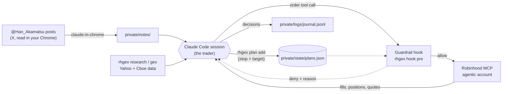
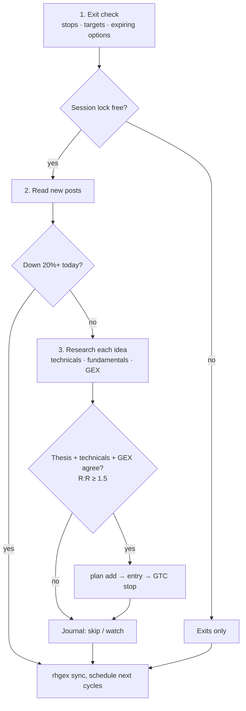
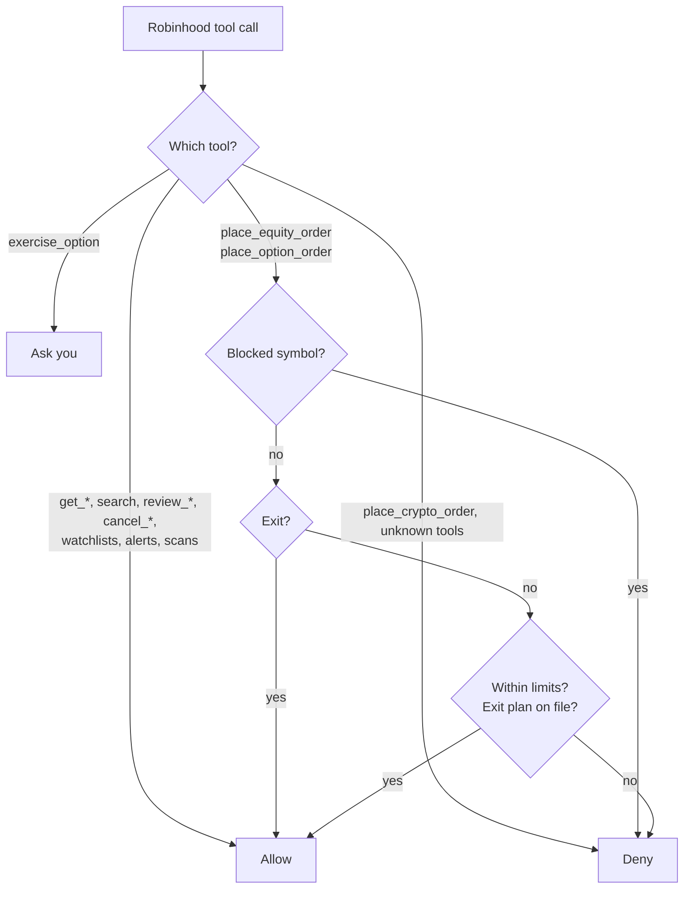
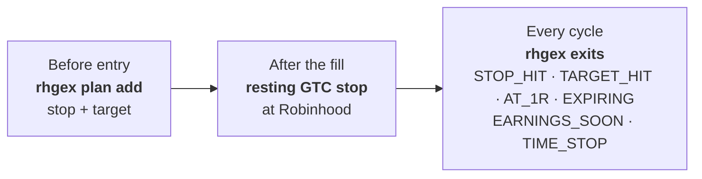

# rh-gex-trader

A Claude Code session that trades a small Robinhood **agentic** account. It reads the gamma/GEX posts of
[@Han_Akamatsu](https://x.com/Han_Akamatsu) (a paid X subscription), checks each idea against its own
technical, fundamental and gamma analysis, and places orders through the Robinhood MCP server. A hook enforces
hard limits on every order, and every position has an exit plan before it opens.

The repo is shared; your account isn't. Your limits, notes, journal and exit plans live in `private/`, your own
private git repo inside this folder.

> **Experimental software that trades real money.** Fund the agentic account only with money you can lose.
> That balance is the real upper bound on what can go wrong.

- [Quick start](#quick-start) · [How it works](#how-it-works) · [Setup](#setup) · [Your private folder](#your-private-folder)
- [Track your performance](#track-your-performance) · [Make it yours](#make-it-yours) · [Running it](#running-it) · [Using more than one machine](#using-more-than-one-machine)
- [Updating](#updating) · [Guardrails](#guardrails) · [Exits](#exits) · [Repo layout](#repo-layout) · [Troubleshooting](#troubleshooting) · [Wash sales and taxes](#wash-sales-and-taxes)

## Quick start

**You need:** a Robinhood **agentic** sub-account funded with money you can lose, your own subscription to
[@Han_Akamatsu](https://x.com/Han_Akamatsu), [Claude Code](https://claude.com/claude-code), Chrome with
[Claude in Chrome](https://claude.com/chrome), and a GitHub account.

1. **Install and clone** ([Setup](#setup)), then start `claude` in the folder.
2. **Type `/setup`.** It detects Windows or macOS, checks your tools, runs `uv sync` and the git hooks, makes your
   private folder (a private GitHub repo only you can see), and asks a few questions to fill in your settings.
3. **Do what only you can** (`/setup` ends with this checklist): `/mcp` → `robinhood-trading` → Authenticate, and
   log in to X in Chrome.
4. **Trade:** type `/trading-day` at about 10:15am ET. It runs the rest of the day on its own.

## How it works



**Claude is the trader; the code is the risk desk.** Claude reads the source, does its own research and
decides, but every Robinhood call passes through `rhgex hook pre` first, and anything the hook can't verify is
refused. That split is what makes it safe to run unattended: judgment can be wrong, the limits can't be argued with.

Each cycle runs the same loop:



The source is an input, not an order: most ideas are skipped, and every decision is journaled with the post
behind it. The full rules are in [CLAUDE.md](CLAUDE.md).

## Setup

| | macOS / Linux | Windows (PowerShell) |
|---|---|---|
| **1. Tools** | `brew install git gh uv gitleaks` | `winget install Git.Git GitHub.cli astral-sh.uv Gitleaks.Gitleaks Microsoft.PowerShell`, then **reopen the terminal** |

Install [Claude Code](https://claude.com/claude-code) too. The rest is the same on both:

```sh
gh auth login --web --git-protocol https
gh auth setup-git
gh repo clone chasechipres/rh-gex-trader
cd rh-gex-trader
claude                                     # then: /setup
```

`/setup` does the rest and can be re-run any time: it checks the tools (with the install line for your OS if
one is missing), runs `uv sync` and `git config core.hooksPath .githooks`, logs `gh` in with you, runs
`rhgex init` (below), and fills in your settings from a few questions. It finishes with the steps only you can
do: `/mcp` → robinhood-trading → Authenticate, Claude in Chrome, and the session-start command. By hand, those
middle steps are `uv sync`, `git config core.hooksPath .githooks` and `uv run python -m rhgex init --github`.

Then install [Claude in Chrome](https://claude.com/chrome) and log in to X in that Chrome profile (subscriber
posts need it). The hook finds the right venv Python on either OS, so `.claude/settings.json` is shared.

## Your private folder

Everything about you and your account lives in `private/`: its own git repo, ignored by this one, so nothing
personal lands in the shared repo.

| File | What it holds | Who edits it |
|---|---|---|
| `guardrails.toml` | your limits and blocked symbols (the hook enforces them) | you (Claude asks first) |
| `CLAUDE.md` | autonomy grant, account goal, time zone and cron times, why each symbol is blocked | you |
| `README.md` | your track record | `rhgex record --readme` |
| `notes/` | saved posts, insights about the source, weekly reviews | Claude |
| `logs/` | `journal.jsonl` (every decision), `wash_sales.jsonl` (loss exits) | Claude, via `rhgex` |
| `state/` | `plans.json`, `ledger.jsonl`, `session.lock` (synced); `account.json` (never leaves the machine) | `rhgex` and the hook |

**Pick how it's stored:**

- `rhgex init --github` **(recommended):** creates `github.com/<you>/rh-gex-trader-private`, private, and every
  cycle's `rhgex sync` pushes to it. A second machine or a dead disk loses nothing.
- `rhgex init`: local only. Still committed each cycle for history; back it up yourself. Add GitHub later with `--github`.
- `rhgex init --clone`: a second machine ([more](#using-more-than-one-machine)).

Both flags take a name or URL (`--github my-data`, `--clone <URL>`). `init` never overwrites a file, and
`rhgex init --check` reports what's set up. Until `private/guardrails.toml` exists, the hook refuses every order.
The [templates](templates/private) are a complete example; every line meant for you is marked `EDIT` with a
cautious alternative.

**Moving a setup from before the split:** run `rhgex init --migrate --github` once, outside market hours, on the
machine that ran the last cycle. It copies your old `guardrails.toml`, `state/`, `logs/` and `notes/` into
`private/` (from git history if a pull already deleted them) and rebuilds the track record. If `from_history`
names the wrong commit, re-run into an empty `private/` with `--from <commit>`. Then `rhgex init --clone` on
each other machine.

## Track your performance

[**Find your private repo**](https://github.com/search?q=rh-gex-trader-private+in%3Aname+user%3A%40me&type=repositories)
(searches your own repos while you're logged in; `rhgex init --check` prints the URL if you renamed it).

| Where | What |
|---|---|
| `private/README.md` | **Track record:** account value, win rate, realized P/L, each closed trade, results by Claude's confidence at entry |
| `private/logs/journal.jsonl` | every decision (trade, skip, watch, exit) with its thesis, confidence and source post |
| `private/notes/reviews/` | weekly review: P/L by setup, which rules fired, rule changes Claude proposes |
| `private/notes/insights.md` | the source's calls versus what happened |

Only exits logged with a P/L count, so skipped ideas and open positions can't inflate the record. Refresh it any
time with `uv run python -m rhgex record --readme --account-value 1000`, or ask Claude "how am I doing this week?"

## Make it yours

Rules come in three layers, from hardest to softest:

| Layer | File | What goes in it | Enforced by |
|---|---|---|---|
| **Hard limits** | `private/guardrails.toml` | size per order and per day, daily loss stop, drawdown pause, blocked symbols | the hook, on every order |
| **Your instructions** | `private/CLAUDE.md` | autonomy, goal, time zone, standing preferences, in plain English | Claude; wins over the playbook |
| **The playbook** | `CLAUDE.md` (shared) | how Claude researches, enters, sizes and exits | Claude; the same for everyone |

```toml
[limits]
max_option_premium_pct = 5      # max loss per option order, % of the account
max_order_usd = 300             # also cap in dollars (any max_<name>_pct takes a _usd partner)
max_new_positions_per_day = 2

[[blocked]]                     # never trade these (or their options) in either direction
name = "held in my IRA"
symbols = ["AAPL", "MSFT"]
until = ""                      # or "YYYY-MM-DD" for a block that expires
```

Examples for `private/CLAUDE.md`: "Ask me before every entry." · "No biotech." · "Options only." · "Notify me only
for fills and stop-outs." · "My computer is on Central time." To change a rule for everyone, open a pull request
(`main` is protected; see [CONTRIBUTING.md](CONTRIBUTING.md)). Weekly reviews propose rule changes;
you decide.

## Running it

| You type | What happens |
|---|---|
| `/setup` | Sets up this machine, or checks an existing setup |
| `/trading-day` | Starts the day: same as the line below |
| `run a trading cycle per CLAUDE.md` | Full cycle: exits, new posts, research, trades; schedules the rest of the day |
| `run an exit check per CLAUDE.md` | Exits only: quick and cheap |
| `/loop run an exit check per CLAUDE.md` | Self-paced exit checks: 15 min with a spread or missing stop, 30 min with all stops resting, 60 min with nothing open |

**A day:** type `/trading-day` around 10:15am ET. It schedules cycles at about 12:30 and 3:00pm ET (when the
source posts most) plus the exit loop, which stops after the close and schedules tomorrow's 10:13am cycle. Leave
the session open and the computer awake; it keeps going day to day. Orders go in only 9:35am–3:50pm ET.
`/model sonnet` stretches a Pro plan. To run it around the clock without leaving your own computer on, see
[Run it 24/7 on a free cloud server](docs/cloud.md).

The tools work on their own too:

```sh
uv run python -m rhgex research NVDA --gex       # technicals + fundamentals + gamma
uv run python -m rhgex gex SPX                   # regime, zero-gamma flip, call/put walls
uv run python -m rhgex blocks                    # blocked symbols, limits, today's orders
uv run python -m rhgex exits                     # open plans vs current prices
uv run python -m rhgex size --account 1000 --option-cost 45   # contracts for 5% risk
uv run python -m rhgex fit XYZ --direction bullish --target 110 --budget 50   # calls/verticals that fit
uv run python -m rhgex preflight XYZ --direction bullish --price 100 --stop 95 --target 110 \
  --expiration 2026-11-20 --leg 4.00,4.20,2500 --source <post link>   # entry checklist
```

## Using more than one machine

Any mix of Windows and Mac works. Code and rules come from this repo (`git pull`); your data from your private
repo (`rhgex sync`). Needs the GitHub-synced private folder (`rhgex init --github`) on your first machine.

**Add a machine** (after installing the tools from [Setup](#setup)):

```sh
gh auth login --web --git-protocol https && gh auth setup-git
gh repo clone chasechipres/rh-gex-trader && cd rh-gex-trader
claude                                     # then /setup: it finds your private repo and clones it
```

**Start every session with this** (from the repo folder; Windows needs PowerShell 7, `pwsh`, for `&&`):

```sh
git switch main && git pull --ff-only && uv sync && uv run python -m rhgex sync --pull && claude
```

It gets the latest code, rules, dependencies and your plans/ledger/lock before Claude loads, and doesn't start
Claude if any step fails. Save it as a shell alias or your terminal's startup command for the repo folder.

**Hand off mid-day** (on the machine that ran the day; the evening's last exit check does this for you):

```sh
uv run python -m rhgex lock release && uv run python -m rhgex sync -m "handoff"
```

What's effective about it:

- **One machine trades at a time.** Each cycle takes `private/state/session.lock` and syncs it; another machine
  places no new entries while it's under 3 hours old. Exits are never blocked. Close the old session so both
  don't run exit checks.
- **Shared caps.** The order ledger syncs, so daily limits count orders from every machine (rows hold only time,
  symbol, side, cost and order id).
- **Local on purpose:** `private/state/account.json` (account values), so each machine keeps its own drawdown peak.
- **Time zones:** cron uses each machine's clock. If they differ, say so in `private/CLAUDE.md`.

## Updating

The session-start command above does it. By hand:

```sh
git pull && uv sync                       # new code, rules and dependencies
uv run python -m rhgex init               # adds new template files; never overwrites yours
```

Cycles also pull and `uv sync` on their own, but a running session keeps the `CLAUDE.md` it started with: when
a pull changes `CLAUDE.md` or `.claude/`, Claude finishes the exit check, skips new entries and asks you to
restart. `init` lists `new_limits_to_add`, settings your `guardrails.toml` doesn't have yet; copy them from
`templates/private/guardrails.toml` (the code's defaults apply until you do).

## Guardrails



**Why it works:** it fails closed. An order it can't parse, a symbol it can't resolve, or a missing account
value is a denial, and exits always pass so a limit can never trap you in a position. Defaults from
`templates/private/guardrails.toml`, as a share of the account's value (yours are in `private/guardrails.toml`;
every limit there is commented). The hook records the value whenever Claude calls `get_portfolio` and refuses
entries until it has today's:

| Limit | Value |
|---|---|
| Stock order | ≤ 75% of the account, limit orders (or a dollar-amount market buy) |
| Options | ≤ 8% of the account max loss per order; long calls/puts or 1:1 verticals only; ≥ 3 days to expiry |
| Per day | ≤ 3 new positions, ≤ 100% of the account deployed |
| Daily loss stop | no new entries once the account is 20% below its first `get_portfolio` value of the day (`max_daily_loss_pct`); exits always pass |
| Drawdown pause | no new entries once the account is 30% below its highest recorded value (`max_drawdown_pct`); you resume it with `rhgex peak reset` |
| Blocked both ways | nothing by default; the template has commented-out examples (index funds you also buy elsewhere, stocks you hold elsewhere) |

Claude can't edit `private/state/`: it's on its deny list, and only `rhgex` commands change it. Editing the hook
code (`rhgex/hook.py`, `guardrails.py`, `dailyloss.py`, `exits.py`, `paths.py`), your limits
(`private/guardrails.toml`) or `.claude/settings.json` asks you first: read the diff and approve it only when
you asked for that change. A force-push asks first too (for cleaning up a branch); GitHub still refuses any
force-push to `main`.

## Exits



**Why it works:** three independent layers. The hook won't open a position without a plan; the resting stop
protects it even when no session is running; the exit check catches what a resting order can't (targets,
expiry, earnings, spreads).

- **Sizing:** options first (it's a growth account), shares as the fallback. Every trade is sized so a full loss
  costs **5% of the account**.
- **Entries:** liquid legs only (spread ≤ 10% of mid or $0.05, open interest ≥ 500; a spread's sold leg ≥ 100), reward:risk ≥ 1.5, posts from the last
  2 trading days, at most 2 positions per theme and 5 still at risk. `rhgex preflight` checks these.
- **Winners run:** at 1R the stop moves to breakeven; at +100% or the target half is sold and the rest trails,
  giving back at most about a third of the gain. Spreads close at about 80% of max value.
- **Losers and stale trades:** the exit check closes options two days before expiry, closes ahead of earnings,
  and exits shares that haven't reached 1R in 10 trading days. A fading thesis gets its stop tightened or is sold.
- **Configurable:** override any of these for yourself in `private/CLAUDE.md`, e.g. "risk 3% per trade"
  (Claude passes it to `rhgex size --pct`). The hook's limits still cap every order.

If no session is running, only the resting stops protect your positions. Spreads and fractional shares can't
have them.

## Repo layout

```
rh-gex-trader/              shared (this repo)
├── CLAUDE.md               the playbook Claude follows; imports private/CLAUDE.md
├── CONTRIBUTING.md         how to change this repo
├── .mcp.json               Robinhood MCP server (URL only, no credentials)
├── .claude/                guardrail hooks, permission lists, the /setup and /trading-day skills
├── .githooks/pre-commit    secret scan (both repos) + tests (this repo)
├── docs/cloud.md           run it 24/7 on a free Oracle Cloud server
├── rhgex/
│   ├── __init__.py         the command line
│   ├── paths.py            where everything lives
│   ├── init.py             set up and sync private/
│   ├── hook.py             pre/post hooks on every Robinhood call
│   ├── guardrails.py       order checks
│   ├── exits.py            exit plans and the exit check
│   ├── watches.py          watch triggers, checked every exit check
│   ├── dailyloss.py        daily loss stop and drawdown pause
│   ├── sizing.py           position size for a fixed % risk
│   ├── preflight.py        pre-trade checklist
│   ├── lock.py             one machine at a time
│   ├── record.py           track record
│   ├── calls.py            the source's calls, scored
│   ├── washlog.py          wash-sale log (logging only)
│   ├── market.py           technicals + fundamentals (Yahoo Finance)
│   ├── indicators.py       EMA, RSI, ATR
│   ├── gex.py              gamma profile (Cboe delayed chains)
│   └── fit.py              option structures that fit the risk budget
├── templates/private/      what `rhgex init` copies into private/
├── scripts/                owner tools
├── tests/                  unit tests, plus README facts vs the code
└── private/                YOUR private repo, ignored here
```

Run the tests with `uv run python -m unittest discover -s tests -t .`. The pre-commit hook runs them when code,
templates, `README.md` or `CLAUDE.md` is staged, so a change that leaves this README stale is refused.

## Troubleshooting

| Symptom | Fix |
|---|---|
| Every order is denied: "private/guardrails.toml is missing" | Set up your private folder: `/setup` (or `uv run python -m rhgex init`). |
| `rhgex sync` says "pull failed" | Two machines changed the same private file. Resolve it in `private/` by hand (ask Claude to explain the conflict, not to merge `state/`). |
| Every Robinhood call says "guardrail hook failed to run" | The venv is missing: run `uv sync` in the repo folder. |
| `uv: command not found` (Windows) | Restart the terminal after installing, then restart `claude`. |
| Claude says the rules changed and asks for a restart | Exit `claude`, run the session-start command, start it again. Open positions stay protected meanwhile. |
| `robinhood-trading` isn't in `/mcp` | Start `claude` from inside the repo folder; the server is defined in `.mcp.json`. |
| `/mcp` shows "Needs authentication" | `/mcp` → robinhood-trading → Authenticate. |
| Claude can't read subscriber posts | Log in to X in the Chrome profile the extension uses. |
| An order is denied | Read the reason: it names the limit. Change `private/guardrails.toml` yourself if the limit is wrong. |

## Wash sales and taxes

Not tax advice. Robinhood's 1099 doesn't see buys in your other accounts: a loss on SPY within 30 days of a VOO
buy in a 401k may be permanently disallowed, so block those funds and use SPX/XSP options (Section 1256 contracts,
generally considered outside the wash-sale rules). It also misses wash sales through options on the same stock.
For those, Claude logs every losing exit with `rhgex wash add`; `rhgex blocks` shows open windows as warnings, and
`rhgex wash list --all` is the record to check at tax time.

**Block the lookalikes too.** The hook matches exact symbols, so a block on one ticker doesn't cover funds that
track the same thing. When you block a fund or stock, list its other share classes and issuers and the
leveraged and inverse funds on it in the same entry. Whether a leveraged fund is "substantially identical" is
unsettled, and blocking them also closes a side door into exposure you've ruled out. For example:

| Blocking | Also block |
|---|---|
| An S&P 500 fund (SPY, VOO, IVV, SPLG, SPYM) | SSO, UPRO, SPXL (2-3x long); SH, SDS, SPXU, SPXS (inverse) |
| A Nasdaq-100 fund (QQQ, QQQM) | QLD, TQQQ (2-3x long); PSQ, QID, SQQQ (inverse) |
| A single stock | Its single-stock leveraged ETFs (Defiance, Tradr, Leverage Shares, GraniteShares and others list 2x long and short funds on popular names) |

Single-stock funds launch often, so check again when you add a block (search "2x &lt;ticker&gt; ETF").
