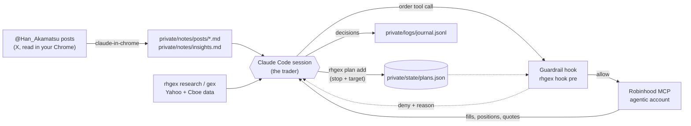
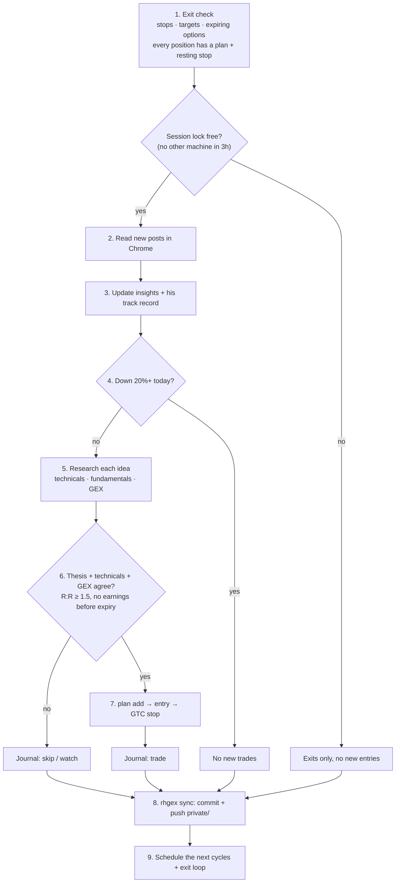
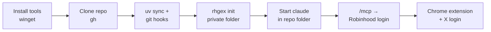
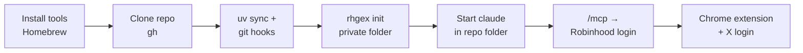
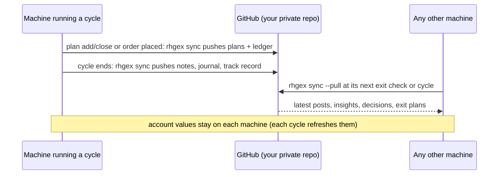
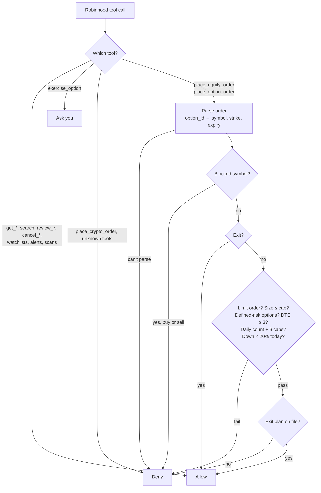
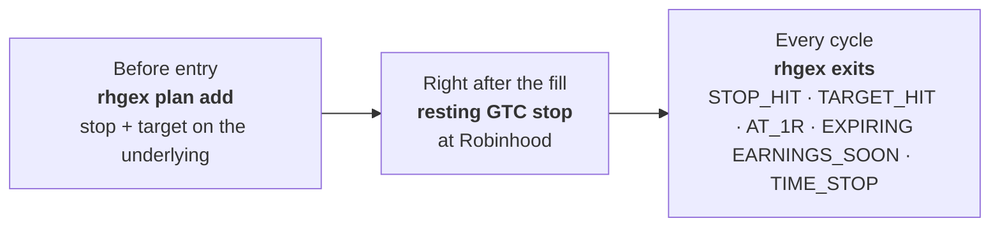

# rh-gex-trader

A Claude Code session that trades a small Robinhood **agentic** account. It reads the gamma/GEX posts of
[@Han_Akamatsu](https://x.com/Han_Akamatsu) (a paid X subscription), checks every idea against its own
technical, fundamental and gamma analysis, and places orders through the Robinhood MCP server. A hook
enforces hard limits on every order, and every position gets an exit plan before it's opened.

The repo is shared; your account isn't. Your limits, blocked symbols, notes, journal and exit plans live in
`private/`, your own private git repo inside this folder. `rhgex init` creates it from clear templates
([Your private folder](#your-private-folder)).

> **Experimental software that trades real money.** Fund the agentic account only with money you can lose.
> That balance is the real upper bound on what can go wrong.

- [Quick start](#quick-start) · [How it works](#how-it-works) · [Setup: Windows](#setup-windows) · [Setup: macOS](#setup-macos)
- [Your private folder](#your-private-folder) · [Track your performance](#track-your-performance) · [Make it yours](#make-it-yours) · [Updating](#updating)
- [Running it](#running-it) · [Using more than one machine](#using-more-than-one-machine) · [Guardrails](#guardrails) · [Exits](#exits)
- [Repo layout](#repo-layout) · [Troubleshooting](#troubleshooting) · [Wash sales and taxes](#wash-sales-and-taxes)

## Quick start

**You need:** a Robinhood account with an **agentic** sub-account funded with money you can lose, your own
subscription to [@Han_Akamatsu](https://x.com/Han_Akamatsu) on X, [Claude Code](https://claude.com/claude-code),
Chrome with the [Claude in Chrome](https://claude.com/chrome) extension, and a GitHub account.

1. **Install and clone** (details: [Windows](#setup-windows) · [macOS](#setup-macos)):
   `gh repo clone chasechipres/rh-gex-trader`, then in the folder `uv sync` and `git config core.hooksPath .githooks`.
2. **Make your private folder:** `uv run python -m rhgex init --github`. It creates
   `github.com/<your-username>/rh-gex-trader-private`, a repo only you can see, for your limits, notes, journal
   and results ([more](#your-private-folder)).
3. **Make it yours:** edit every line marked `EDIT` in `private/guardrails.toml` (your hard limits) and
   `private/CLAUDE.md` (whether Claude may trade without asking, your time zone, symbols to avoid)
   ([more](#make-it-yours)). Then `uv run python -m rhgex sync -m "my settings"`.
4. **Connect:** start `claude` in the folder, run `/mcp` → `robinhood-trading` → Authenticate, and log in to X
   in Chrome.
5. **Trade:** type `/trading-day` at about 10:15am ET ([Running it](#running-it)). Your results build up in
   `private/README.md` ([Track your performance](#track-your-performance)).

## How it works



Claude is the trader; the code is the risk desk. Claude reads the source, does its own research, and
decides. It can't get around the hook: every Robinhood tool call passes through `rhgex hook pre` first, and
anything the hook can't verify is refused.

### Each cycle



The full rules Claude follows are in [CLAUDE.md](CLAUDE.md).

## Setup: Windows



**1. Install the tools** (PowerShell):

```powershell
winget install Git.Git GitHub.cli astral-sh.uv Gitleaks.Gitleaks
```

Install Claude Code if you don't have it: <https://claude.com/claude-code>. Then **close and reopen the
terminal** so the new tools are on PATH. (Skipping this is the #1 cause of "uv: command not found" in the
guardrail hook.)

**2. Sign in to GitHub and clone:**

```powershell
gh auth login --web --git-protocol https
gh auth setup-git
gh repo clone chasechipres/rh-gex-trader
cd rh-gex-trader
```

**3. Install dependencies and turn on the secret-scanning hook:**

```powershell
uv sync
git config core.hooksPath .githooks
```

**4. Create your private folder** (pick one; details in [Your private folder](#your-private-folder)):

```powershell
uv run python -m rhgex init --github   # synced: creates <you>/rh-gex-trader-private on GitHub, private
uv run python -m rhgex init            # or: only on this machine
uv run python -m rhgex init --clone    # or: another machine, clones <you>/rh-gex-trader-private
```

Then edit every line marked `EDIT` in `private/guardrails.toml` and `private/CLAUDE.md`.

**5. Start Claude Code in the repo folder**, then connect Robinhood:

```powershell
claude
```

```
/mcp   →  robinhood-trading  →  Authenticate   (browser opens for the Robinhood login)
```

Approve the project's MCP server if Claude Code asks.

**6. Chrome:** install the [Claude in Chrome](https://claude.com/chrome) extension and make sure you're
logged in to X in that Chrome profile (needed for subscriber-only posts).

## Setup: macOS



**1. Install the tools** (Terminal; needs [Homebrew](https://brew.sh)):

```sh
brew install git gh uv gitleaks
```

Install Claude Code if you don't have it: <https://claude.com/claude-code>.

**2. Sign in to GitHub and clone:**

```sh
gh auth login --web --git-protocol https
gh auth setup-git
gh repo clone chasechipres/rh-gex-trader
cd rh-gex-trader
```

**3. Install dependencies and turn on the secret-scanning hook:**

```sh
uv sync
git config core.hooksPath .githooks
```

**4. Create your private folder:** same commands as Windows step 4, then edit the `EDIT` lines.

**5. Start Claude Code in the repo folder**, then connect Robinhood:

```sh
claude
```

```
/mcp   →  robinhood-trading  →  Authenticate
```

**6. Chrome:** same as Windows: install Claude in Chrome and log in to X.

### What's different between the two

| | Windows | macOS |
|---|---|---|
| Package manager | `winget` | `brew` |
| venv Python (used by the hook) | `.venv\Scripts\python.exe` | `.venv/bin/python` |
| After installing tools | restart the terminal | nothing extra |

The hook command picks the right venv Python automatically, so `.claude/settings.json` is the same on both.

## Your private folder

Everything about you and your account lives in `private/`: its own git repo, cloned inside this one and
ignored by it, so nothing personal ever lands in the shared repo.

| File | What it holds | Who edits it |
|---|---|---|
| `guardrails.toml` | your limits and blocked symbols (the hook enforces them) | you (Claude asks first) |
| `CLAUDE.md` | autonomy grant, account goal, time zone and cron times, why each symbol is blocked | you |
| `README.md` | your track record | `rhgex record --readme` |
| `notes/` | saved posts, insights about the source, weekly reviews | Claude |
| `logs/` | `journal.jsonl` (every decision), `wash_sales.jsonl` (loss exits) | Claude, via `rhgex` |
| `state/` | `plans.json`, `ledger.jsonl`, `session.lock` (synced); `account.json` (never leaves the machine) | `rhgex` and the hook |

The templates in [`templates/private/`](templates/private) are a complete example with
placeholder values (a small high-growth, options-first account), and every line meant for you to change is marked `EDIT` with what it does and a cautious alternative.

**Synced or local only: your choice.**

- **Synced through GitHub (recommended):** `rhgex init --github` creates a **private** repo,
  `github.com/<your-username>/rh-gex-trader-private`, under whichever account `gh` is logged in as, and pushes to
  it. Each cycle's `rhgex sync` pushes your notes, journal and plans, so another machine or a dead disk loses
  nothing. Only you can open it.
- **Local only:** `rhgex init` keeps a git repo on this machine and nothing leaves it. `rhgex sync` still
  commits each cycle, so you have the history, but back the folder up yourself. Add a remote any time with
  `rhgex init --github`.
- **Another machine** (any OS): `rhgex init --clone` clones `<your-username>/rh-gex-trader-private`
  ([more](#using-more-than-one-machine)).

Both flags take a name or URL if you want a different repo: `--github my-trading-data`, `--clone <URL>`. Without
one, they need `gh auth login` (setup step 2).

`rhgex init` never overwrites a file, so it's safe to re-run, and `rhgex init --check` reports what's set up.
Until `private/guardrails.toml` exists, the hook refuses every order.

**Moving an existing setup (from before the split):** run `rhgex init --migrate --github` (or without
`--github` for local only) once, on the machine that ran the last cycle. It copies `guardrails.toml`, `state/`,
`logs/` and `notes/` into `private/`, from disk or, if a pull already deleted them, from git history, and
rebuilds your track record in `private/README.md` from the journal. Files from history are listed under
`from_history` with the commit they came from; if that's not your last real commit before the split, re-run
into an empty `private/` with `--from <that commit>`. Then on each other machine: `git pull`, then
`rhgex init --clone`. Do it outside market hours; resting stops at Robinhood keep protecting positions meanwhile.

## Track your performance

Everything is recorded in your private repo, so you can read it on GitHub from anywhere:

| Where | What | Updated by |
|---|---|---|
| `private/README.md` | **Track record:** account value, closed trades, win rate, realized P/L, each closed trade, and results by Claude's confidence at entry | every cycle (`rhgex record --readme`) |
| `private/logs/journal.jsonl` | every decision (trade, skip, watch, exit) with the thesis, confidence 0-1, the post behind it, and the P/L of each exit | every decision (`rhgex journal`) |
| `private/notes/reviews/` | weekly review: P/L by setup and by confidence, which rules fired and how those trades did, rule changes Claude proposes | the last cycle of each week |
| `private/notes/insights.md` | the source's calls versus what actually happened | as posts come in |
| `private/logs/wash_sales.jsonl` | losing exits and their 30-day wash-sale windows, for tax time | every losing exit |

Only exits logged with a P/L count toward the track record, so skipped ideas and open positions never inflate
it. To check without waiting for a cycle:

```sh
uv run python -m rhgex record                                 # the numbers, as JSON
uv run python -m rhgex record --readme --account-value 1000   # refresh private/README.md
uv run python -m rhgex sync -m "track record"                 # push it to your private repo
```

Or just ask Claude in a session: "how am I doing this week?" It reads the journal and the reviews.

## Make it yours

Your rules come in three layers. The two in `private/` are yours alone; commit them with `rhgex sync`.

| Layer | File | What goes in it | Enforced by |
|---|---|---|---|
| **Hard limits** | `private/guardrails.toml` | size per order and per day, daily loss stop, drawdown pause, blocked symbols | the hook, on every order; Claude asks before editing this file |
| **Your instructions** | `private/CLAUDE.md` | autonomy, account goal, time zone and cron times, why symbols are blocked, standing preferences | Claude; wins over the playbook where they differ |
| **The playbook** | `CLAUDE.md` (shared) | how Claude researches, enters, sizes and exits | Claude; the same for every user |

**Hard limits** (`private/guardrails.toml`, which you edit yourself):

```toml
[limits]
max_option_premium_pct = 5      # max loss per option order, % of the account
max_order_usd = 300             # also cap stock orders in dollars (any max_<name>_pct takes a _usd partner)
max_new_positions_per_day = 2

[[blocked]]                     # never trade these (or their options) in either direction
name = "held in my IRA"
symbols = ["AAPL", "MSFT"]
until = ""                      # or "YYYY-MM-DD" for a block that should expire, like a wash-sale window
```

Every limit has a comment in the file saying what it does and a cautious value. An order that breaks a limit is
refused with the reason; exits always go through.

**Your instructions** (`private/CLAUDE.md`), in plain English. For example:
- "Ask me before every entry." (Delete the autonomy grant, and Claude asks before each order.)
- "No crypto miners or biotech." / "Options only, never shares." / "At most one new trade a day."
- "Notify me only for fills and stop-outs."
- "My computer is on Central time." (So cron times and post file names line up.)

**The playbook** (`CLAUDE.md`) is shared. To change a rule for everyone, open a pull request. To change it
only for you, write the override in `private/CLAUDE.md`, and it wins. Each weekly review ends with rule
changes Claude proposes; you decide whether to adopt them.

## Updating

```sh
git pull                              # new code and rules
uv sync                               # new dependencies, if any
uv run python -m rhgex init           # adds any new template files; never overwrites yours
```

`init` lists `new_limits_to_add`: settings the template gained that your `guardrails.toml` doesn't have yet.
Copy them over from `templates/private/guardrails.toml` (until you do, the code's defaults apply).

## Running it

Open Claude Code in the repo folder and type one of these:

| You type | What happens |
|---|---|
| `/trading-day` | Starts the day: same as the line below |
| `run a trading cycle per CLAUDE.md` | Full cycle: exits, new posts, research, trades; schedules the rest of the day's cycles and the exit loop |
| `run an exit check per CLAUDE.md` | Exits only: quick, cheap, safe to run often |
| `/loop run an exit check per CLAUDE.md` | Self-paced exit checks during market hours: every 15 min with a spread, fractional shares or a missing stop, 30 min when every position has a resting stop, 60 min with nothing open (stops itself after the close) |

A typical day: type `/trading-day` once, at about 10:15am ET (7:15am PT). That cycle
schedules two more (about 12:30pm and 3:00pm ET) and the self-paced exit-check loop, which stops itself
after the close and schedules the next morning's 10:13am ET cycle. Leave the session open and it keeps
going day to day; a cycle you run in the evening just schedules the next morning. The times follow when
the source posts: most of his posts land 8am–noon ET. Keep the
session open and the computer awake: scheduled runs only happen while the session does. Use `/model sonnet` to
stretch a Pro plan's usage. Orders are only placed 9:35am–3:50pm ET.

You can also run the tools yourself:

```sh
uv run python -m rhgex research NVDA ARM --gex   # technicals + fundamentals + gamma
uv run python -m rhgex gex SPX                   # regime, zero-gamma flip, call/put walls
uv run python -m rhgex blocks                    # blocked symbols, limits, today's orders
uv run python -m rhgex plan list                 # open exit plans
uv run python -m rhgex exits                     # plans vs current prices
uv run python -m rhgex size --account 1000 --option-cost 45   # contracts for 5% risk
uv run python -m rhgex init --check            # what's set up in private/
uv run python -m rhgex sync -m "notes"         # commit private/ (and push it, if it has a remote)
uv run python -m rhgex preflight XYZ --direction bullish --price 100 --stop 95 --target 110 \
  --expiration 2026-11-20 --leg 4.00,4.20,2500 --leg 1.50,1.60,1800 --source <post link>   # entry checklist
```

## Using more than one machine

Run it from any mix of computers: a Windows desktop and a MacBook, two Macs, a work laptop and a home PC. Each
one gets the shared repo from GitHub and your data from your private repo; nothing depends on which OS ran
the last cycle.



**Add a machine** (needs the synced setup, `rhgex init --github`, on your first one):

1. Set it up like the first: [Windows](#setup-windows) or [macOS](#setup-macos), up to `uv sync`.
2. `uv run python -m rhgex init --clone`: clones `<your-username>/rh-gex-trader-private` into `private/`.
3. Start `claude` there and authenticate `robinhood-trading` with `/mcp`; log in to X in that machine's Chrome.

Repeat for as many machines as you like. Code and rules come from the shared repo (`git pull`); your data from
your private repo (`rhgex sync`).

- **Synced:** everything in `private/` except `state/account.json`: posts, insights, the journal, wash-sale
  log, exit plans, the order ledger (so every machine counts one set of daily caps; rows hold only the time,
  symbol, side, cost and order id) and the session lock.
- **Local only:** `private/state/account.json` (account values, refreshed every cycle), so each machine tracks
  its own drawdown peak.
- **One machine at a time, enforced:** each cycle takes `private/state/session.lock` and syncs it; any other
  machine places no new entries while that lock is under 3 hours old. Machines only see each other's orders
  after a sync, so two running at once could still exceed the daily caps. Pick one to run the day; switch after
  the close (the day's last exit check releases the lock), or with `rhgex lock release` and a sync on the first.
- **Time zones:** cron and post file names use each machine's own clock. If your machines are in different
  time zones, say so in `private/CLAUDE.md` (e.g. "the desktop is on Eastern, the laptop on Pacific") so
  Claude converts the 10:13 / 12:33 / 15:03 ET cycle times correctly.

## Guardrails



Default limits from `templates/private/guardrails.toml`, as a percentage of the account's value. Yours are
in `private/guardrails.toml`. The hook records the value whenever Claude calls `get_portfolio`, and refuses new
positions until it has today's value:

| Limit | Value |
|---|---|
| Stock order | ≤ 75% of the account, limit orders (or a dollar-amount market buy) |
| Options | ≤ 8% of the account max loss per order; long calls/puts or 1:1 verticals only; ≥ 3 days to expiry |
| Per day | ≤ 3 new positions, ≤ 100% of the account deployed |
| Daily loss stop | no new entries once the account is 20% below its first `get_portfolio` value of the day (`max_daily_loss_pct`); exits always pass |
| Drawdown pause | no new entries once the account is 30% below its highest recorded value (`max_drawdown_pct`); you resume it with `rhgex peak reset` |
| Blocked both ways | nothing by default; the template has commented-out examples (index funds you also buy elsewhere, stocks you hold elsewhere) |

Claude can't edit the hook code (`rhgex/hook.py`, `guardrails.py`, `dailyloss.py`, `exits.py`, `paths.py`),
`private/state/` or `.claude/settings.json`: those are on its deny list. Editing your limits
(`private/guardrails.toml`) asks you first: approve it only when you asked for that change in the session.
If the hook fails to run, the call is blocked.

## Exits

Every position has three layers of protection:



**Sizing (options first).** The account is run for growth, so trades use options whenever a liquid structure
fits; shares are the fallback. `rhgex size` sets the size so a full loss costs **5% of the account**,
whether that's an option's premium or the distance from a share entry to its stop.

**Entry checks for options.** Every leg needs a bid/ask spread of at most 10% of mid and open interest of at
least 500. Single legs are bought near the money (delta ~0.45-0.60); spreads sell the short leg at the target or
the gamma wall. High IV calls for a spread. At most 2 positions per sector or theme, only posts from the last 2
trading days, no re-entry for 2 days after a stop-out, and an unfilled entry is re-priced once, then cancelled.
At most 5 positions can be open with their stop below breakeven. `rhgex preflight` checks all of these on a
proposed trade (PASS/FAIL per rule) before the exit plan is written.

**Letting winners run.** At 1R of profit the stop moves to breakeven (`rhgex plan raise-stop`, which can only
tighten a stop). At +100% on an option's premium, or at the target, half is sold and the rest trails, so it
gives back no more than about a third of the open gain. Rolls and adds are new entries with their own 5% risk.
Option trades prefer 2 contracts so half can be sold; a single contract is sold whole at +100% unless the
thesis is still running, in which case its stop locks in at least +50%. Spreads close at about 80% of max value.
When a thesis fades (momentum stalls, price pins at a wall, the source goes quiet, expiry nears with no move),
a position up 25%+ is sold, one between 0 and +25% gets a breakeven stop, and a loser keeps its normal stop.

1. **Exit plan.** The hook refuses an entry unless `rhgex plan add` has recorded a stop and target.
   Levels are underlying prices; `--direction bearish` for puts.
2. **Resting stop.** Placed right after the fill so the position is protected even with no session running.
   Shares get a stop order; single-leg options get a stop-limit about 40% below the entry premium. Spreads and
   fractional shares can't have resting stops, so for them the exit check is the only stop.
3. **Exit check.** Starts every cycle: sells on a stop or target, closes options two days before expiry,
   and makes sure every position has both a plan and a resting stop.

If no Claude session is running, only the resting stops protect your positions.

## Repo layout

```
rh-gex-trader/              shared (this repo)
├── CLAUDE.md               the playbook Claude follows every cycle; imports private/CLAUDE.md
├── README.md               this file
├── .mcp.json               Robinhood MCP server (URL only, no credentials)
├── .claude/
│   ├── settings.json       guardrail hooks + permission allow/deny lists
│   └── skills/trading-day/ the /trading-day command that starts the day
├── .githooks/pre-commit    secret scan (both repos) + tests (this repo)
├── pyproject.toml, uv.lock Python dependencies (uv)
├── rhgex/
│   ├── __init__.py         the `rhgex` command line
│   ├── paths.py            where everything lives (private/ for anything personal)
│   ├── init.py             `rhgex init` and `rhgex sync`: set up and sync private/
│   ├── hook.py             pre/post hooks on every Robinhood tool call
│   ├── guardrails.py       order checks (pure functions)
│   ├── exits.py            exit plans and the exit check
│   ├── washlog.py          wash-sale log of loss exits (logging only)
│   ├── record.py           track record: live P/L, win rate by entry confidence
│   ├── dailyloss.py        daily loss stop (start-of-day value vs latest)
│   ├── sizing.py           position size for a fixed % risk (5% for options and shares)
│   ├── lock.py             session lock: one machine at a time
│   ├── preflight.py        pre-trade checklist of the mechanical entry rules
│   ├── market.py           technicals + fundamentals (Yahoo Finance)
│   ├── indicators.py       EMA, RSI, ATR
│   └── gex.py              gamma profile (Cboe delayed chains)
├── templates/private/      what `rhgex init` copies into private/ (marked EDIT where it's yours to change)
├── scripts/move-to-clean-repo.sh   move a checkout onto a clean-history repo, keeping private/ (owner tool)
├── tests/                  unit tests, plus test_readme.py: README facts vs the code (run on commit)
└── private/                YOUR private repo, ignored here (see "Your private folder")
    ├── CLAUDE.md, guardrails.toml, README.md
    ├── notes/              posts/, insights.md, heatseeker-guide.md, reviews/
    ├── logs/               journal.jsonl, wash_sales.jsonl
    └── state/              plans.json, ledger.jsonl, session.lock, account.json (local only)
```

Nothing in `private/` is ever committed to this repo: `.gitignore` excludes it, along with `.env` files,
`.venv/`, caches and any `guardrails.toml`, `state/`, `logs/` or `notes/` left over from before the split.

Run the tests with `uv run python -m unittest discover -s tests -t .`. The pre-commit hook runs them whenever code,
templates, `README.md` or `CLAUDE.md` is staged, so a change that leaves the README stale is refused.

## Troubleshooting

| Symptom | Fix |
|---|---|
| Every order is denied: "private/guardrails.toml is missing" | Set up your private folder: `uv run python -m rhgex init` (see above). |
| `rhgex sync` says "pull failed" | Two machines changed the same private file. Resolve it in `private/` by hand (ask Claude to explain the conflict, not to merge `state/`). |
| Every Robinhood call says "guardrail hook failed to run" | The venv is missing: run `uv sync` in the repo folder. |
| `uv: command not found` (Windows) | Restart the terminal after installing, then restart `claude`. |
| `robinhood-trading` isn't in `/mcp` | Start `claude` from inside the repo folder; the server is defined in `.mcp.json`. |
| `/mcp` shows "Needs authentication" | `/mcp` → robinhood-trading → Authenticate. |
| Claude can't read subscriber posts | Log in to X in the Chrome profile the extension uses. |
| An order is denied | Read the reason: it names the limit. Change `private/guardrails.toml` yourself if the limit is wrong. |

## Wash sales and taxes

Not tax advice. Robinhood's 1099 only tracks wash sales inside your Robinhood account; it doesn't see buys
in your other accounts, like a 401k buying VOO. A loss on SPY (or SPY options) within 30 days of a VOO buy
may be disallowed, and permanently so when the buy is in a retirement account. SPX/XSP options are Section
1256 contracts (60/40 tax treatment, marked to market at year end), and wash-sale rules are generally considered
not to apply to them.

Robinhood's 1099 also misses wash sales that come through options on the same stock, a different strike or
expiry, or your other accounts. For those, Claude logs every losing exit with `rhgex wash add` to
`private/logs/wash_sales.jsonl`, with the window from 30 days before to 30 days after the sale. `rhgex blocks` and
`research` show open windows as warnings; nothing is blocked. At tax time, `rhgex wash list --all` is the record
to check against buys in your other accounts.
