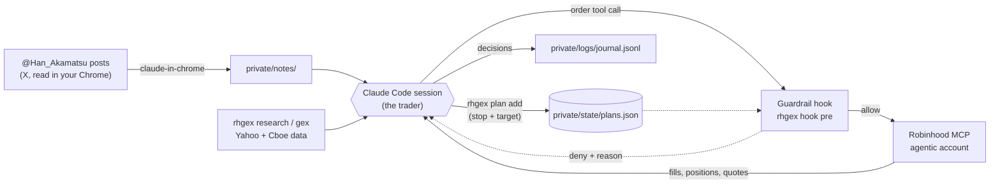

# rh-gex-trader

A Claude Code session that trades a small Robinhood **agentic** account. It reads the gamma/GEX posts of
[@Han_Akamatsu](https://x.com/Han_Akamatsu) (a paid X subscription), checks each idea against its own
technical, fundamental and gamma analysis, and places orders through the Robinhood MCP server. A hook enforces
hard limits on every order, and every position has an exit plan before it opens.

The repo is shared; your account isn't. Your limits, notes, journal and exit plans live in `private/`, your own
private git repo inside this folder.

> **Experimental software that trades real money.** Fund the agentic account only with money you can lose.
> That balance is the real upper bound on what can go wrong.

## Quick start

**You need:** a Robinhood **agentic** sub-account funded with money you can lose, your own subscription to
[@Han_Akamatsu](https://x.com/Han_Akamatsu), [Claude Code](https://claude.com/claude-code), Chrome with
[Claude in Chrome](https://claude.com/chrome), and a GitHub account.

1. **Install and clone** ([Setup](docs/setup.md#install)), then start `claude` in the folder.
2. **Type `/setup`.** It detects Windows or macOS, checks your tools, runs `uv sync` and the git hooks, makes your
   private folder (a private GitHub repo only you can see), and asks a few questions to fill in your settings.
3. **Do what only you can** (`/setup` ends with this checklist): `/mcp` → `robinhood-trading` → Authenticate, and
   log in to X in Chrome.
4. **Trade:** type `/trading-day` at about 10:15am ET. It runs the rest of the day on its own.

## How it works



**Claude is the trader; the code is the risk desk.** Claude reads the source, does its own research and
decides, but every Robinhood call passes through `rhgex hook pre` first, and anything the hook can't verify is
refused. That split is what makes it safe to run unattended: judgment can be wrong, the limits can't be argued with.

The source is an input, not an order: most ideas are skipped, and every decision is journaled with the post
behind it. Three cycles a day (about 10:15am, 12:30pm and 3:00pm ET) read new posts and trade; between them, an
exit check watches stops, targets and triggers. The full rules are in [CLAUDE.md](CLAUDE.md).

## Docs

| Doc | Read it when |
|---|---|
| [Setup and settings](docs/setup.md) | installing, what's in `private/`, changing limits or preferences |
| [Running it](docs/running.md) | the commands and a normal day, more than one machine, your track record, troubleshooting |
| [Guardrails, exits and taxes](docs/safety.md) | what the hook blocks, how positions get out, wash sales |
| [Run it 24/7 on a free cloud server](docs/cloud.md) | you don't want to leave your own computer on |
| [Contributing](CONTRIBUTING.md) | changing the shared code or rules, and the repo layout |

## Updating

The session-start command in [Running it](docs/running.md#using-more-than-one-machine) does it. By hand:

```sh
git pull && uv sync                       # new code, rules and dependencies
uv run python -m rhgex init               # adds new template files; never overwrites yours
```

Cycles also pull and `uv sync` on their own, but a running session keeps the `CLAUDE.md` it started with: when
a pull changes `CLAUDE.md` or `.claude/`, Claude finishes the exit check, skips new entries and asks you to
restart. `init` lists `new_limits_to_add`, settings your `guardrails.toml` doesn't have yet; copy them from
`templates/private/guardrails.toml` (the code's defaults apply until you do).
