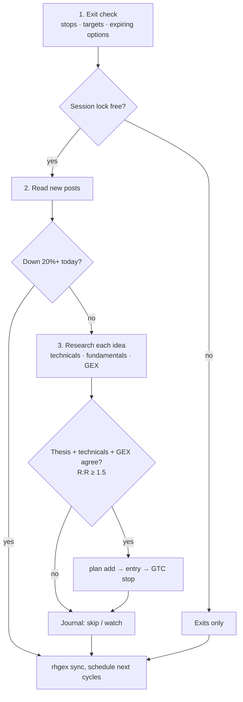

# Running it

The commands, a normal day, more than one machine, your track record, and fixes for common problems.

- [Commands](#commands) · [A cycle](#a-cycle) · [Using more than one machine](#using-more-than-one-machine)
- [Track your performance](#track-your-performance) · [Troubleshooting](#troubleshooting)

## Commands

| You type | What happens |
|---|---|
| `/setup` | Sets up this machine, or checks an existing setup |
| `/trading-day` | Starts the day: same as the line below |
| `run a trading cycle per CLAUDE.md` | Full cycle: exits, new posts, research, trades; schedules the rest of the day |
| `run an exit check per CLAUDE.md` | Exits only: quick and cheap |
| `/loop run an exit check per CLAUDE.md` | Self-paced exit checks: the watcher (`rhgex monitor`) wakes it when a level is crossed, plus a heartbeat of 15 min (options, spreads, no resting stop), 30 min (shares with stops) or 60 min (only watches, or nothing) |

**A day:** type `/trading-day` around 10:15am ET. It schedules cycles at about 12:30 and 3:00pm ET (when the
source posts most) plus the exit loop, which stops after the close and schedules tomorrow's 10:13am cycle. Leave
the session open and the computer awake; it keeps going day to day. Orders go in only 9:35am–3:50pm ET.
`/model sonnet` stretches a Pro plan. To run it around the clock without leaving your own computer on, see
[Run it 24/7 on a free cloud server](cloud.md).

The tools work on their own too:

```sh
uv run python -m rhgex research NVDA --gex       # technicals + fundamentals + gamma
uv run python -m rhgex gex SPX                   # regime, zero-gamma flip, call/put walls
uv run python -m rhgex blocks                    # blocked symbols, limits, today's orders
uv run python -m rhgex exits                     # open plans vs current prices
uv run python -m rhgex monitor --minutes 30      # the watcher: exits with a JSON line on a level cross
uv run python -m rhgex replay --account 1000     # his dip calls on 15-minute bars: dip-buy vs reclaim
uv run python -m rhgex size --account 1000 --option-cost 45   # contracts for 5% risk
uv run python -m rhgex fit XYZ --direction bullish --target 110 --budget 50   # calls/verticals that fit
uv run python -m rhgex preflight XYZ --direction bullish --price 100 --stop 95 --target 110 \
  --expiration 2026-11-20 --leg 4.00,4.20,2500 --source <post link>   # entry checklist
```

## A cycle



The full rules are in [CLAUDE.md](../CLAUDE.md).

## Using more than one machine

Any mix of Windows and Mac works. Code and rules come from this repo (`git pull`); your data from your private
repo (`rhgex sync`). Needs the GitHub-synced private folder (`rhgex init --github`) on your first machine.

**Add a machine** (after installing the tools from [Setup](setup.md#install)):

```sh
gh auth login --web --git-protocol https && gh auth setup-git
gh repo clone chasechipres/rh-gex-trader && cd rh-gex-trader
claude                                     # then /setup: it finds your private repo and clones it
```

**Start every session with this** (from the repo folder; Windows needs PowerShell 7, `pwsh`, for `&&`):

```sh
git switch main && git pull --ff-only && uv sync && uv run python -m rhgex sync --pull && claude
```

It gets the latest code, rules, dependencies and your plans/ledger/lock before Claude loads, and doesn't start
Claude if any step fails. Save it as a shell alias or your terminal's startup command for the repo folder.

**Hand off mid-day** (on the machine that ran the day; the evening's last exit check does this for you):

```sh
uv run python -m rhgex lock release && uv run python -m rhgex sync -m "handoff"
```

What's effective about it:

- **One machine trades at a time.** Each cycle takes `private/state/session.lock` and syncs it; another machine
  places no new entries while it's under 3 hours old. Exits are never blocked. Close the old session so both
  don't run exit checks.
- **Shared caps.** The order ledger syncs, so daily limits count orders from every machine (rows hold only time,
  symbol, side, cost and order id).
- **Shared plans, watches and calls.** Exit plans, open watches (`state/watches.json`) and the source's scored calls
  (`logs/calls.json`) sync too, so the next machine tests the same triggers. A private folder made before
  watches and calls synced gets them added to its `.gitignore` allow-list by its next `rhgex sync`.
- **Local on purpose:** `private/state/account.json` (account values), so each machine keeps its own drawdown peak.
- **Time zones:** cron uses each machine's clock. If they differ, say so in `private/CLAUDE.md`.

## Track your performance

[**Find your private repo**](https://github.com/search?q=rh-gex-trader-private+in%3Aname+user%3A%40me&type=repositories)
(searches your own repos while you're logged in; `rhgex init --check` prints the URL if you renamed it).

| Where | What |
|---|---|
| `private/README.md` | **Track record:** account value, win rate, realized P/L, each closed trade, results by Claude's confidence at entry |
| `private/logs/journal.jsonl` | every decision (trade, skip, watch, exit) with its thesis, confidence and source post |
| `private/notes/reviews/` | weekly review: P/L by setup, which rules fired, rule changes Claude proposes |
| `private/notes/insights.md` | the source's calls versus what happened |

Only exits logged with a P/L count, so skipped ideas and open positions can't inflate the record. Refresh it any
time with `uv run python -m rhgex record --readme --account-value 1000`, or ask Claude "how am I doing this week?"

## Troubleshooting

| Symptom | Fix |
|---|---|
| Every order is denied: "private/guardrails.toml is missing" | Set up your private folder: `/setup` (or `uv run python -m rhgex init`). |
| `rhgex sync` says "pull failed" | Two machines changed the same private file. Resolve it in `private/` by hand (ask Claude to explain the conflict, not to merge `state/`). |
| Every Robinhood call says "guardrail hook failed to run" | The venv is missing: run `uv sync` in the repo folder. |
| Notification: X is logged out, or Chrome is unreachable | Log back in to X in that machine's Chrome (or reopen Chrome). Until then cycles read no new posts and trade nothing new from them; exits and watches keep running. |
| `uv: command not found` (Windows) | Restart the terminal after installing, then restart `claude`. |
| Claude says the rules changed and asks for a restart | Exit `claude`, run the session-start command, start it again. Open positions stay protected meanwhile. |
| `robinhood-trading` isn't in `/mcp` | Start `claude` from inside the repo folder; the server is defined in `.mcp.json`. |
| `/mcp` shows "Needs authentication" | `/mcp` → robinhood-trading → Authenticate. |
| Claude can't read subscriber posts | Log in to X in the Chrome profile the extension uses. |
| An order is denied | Read the reason: it names the limit. Change `private/guardrails.toml` yourself if the limit is wrong. |
