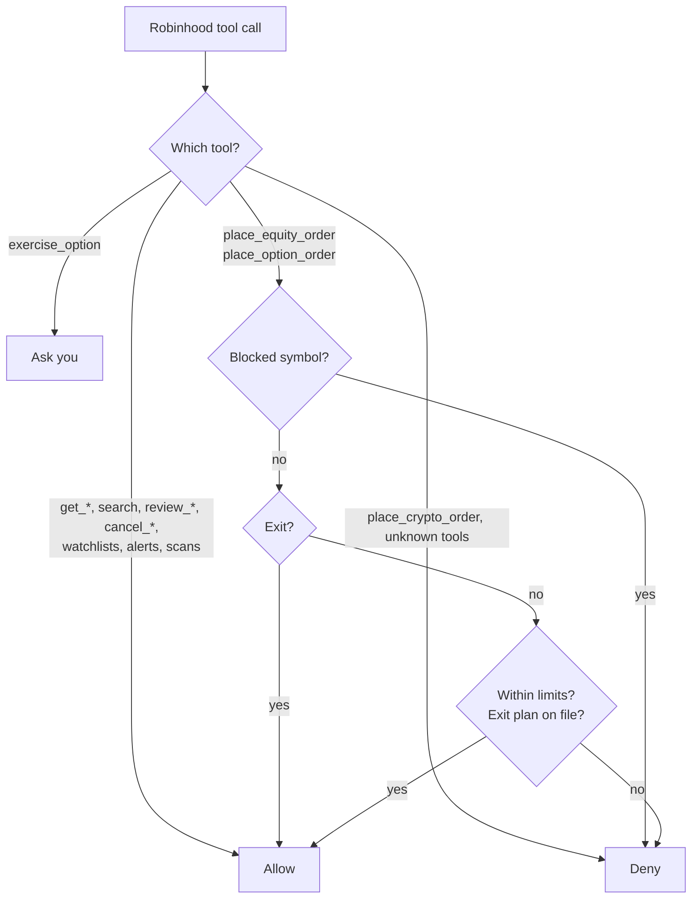
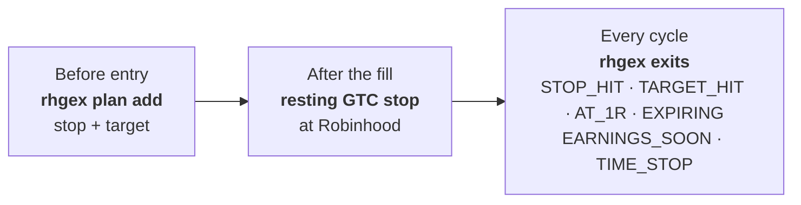

# Guardrails, exits and taxes

What stops a bad order, how every position gets out, and the wash-sale traps. This is an overview: the rules
Claude actually follows are in [CLAUDE.md](../CLAUDE.md), and the limits in your `private/guardrails.toml`.

- [Guardrails](#guardrails) · [Exits](#exits) · [Wash sales and taxes](#wash-sales-and-taxes)

## Guardrails

**Why it works:** it fails closed. An order it can't parse, a symbol it can't resolve, or a missing account
value is a denial, and exits always pass so a limit can never trap you in a position. Defaults from
`templates/private/guardrails.toml`, as a share of the account's value (yours are in `private/guardrails.toml`;
every limit there is commented). The hook records the value whenever Claude calls `get_portfolio` and refuses
entries until it has today's:

| Limit | Value |
|---|---|
| Stock order | ≤ 75% of the account, limit orders (or a dollar-amount market buy) |
| Options | ≤ 8% of the account max loss per order; long calls/puts or 1:1 verticals only; ≥ 3 days to expiry |
| Per day | ≤ 3 new positions, ≤ 100% of the account deployed |
| Daily loss stop | no new entries once the account is 20% below its first `get_portfolio` value of the day (`max_daily_loss_pct`); exits always pass |
| Drawdown pause | no new entries once the account is 30% below its highest recorded value (`max_drawdown_pct`); you resume it with `rhgex peak reset` |
| Blocked both ways | nothing by default; the template has commented-out examples (index funds you also buy elsewhere, stocks you hold elsewhere) |

Claude can't edit `private/state/`: it's on its deny list, and only `rhgex` commands change it. Editing the hook
code (`rhgex/hook.py`, `guardrails.py`, `dailyloss.py`, `exits.py`, `paths.py`), your limits
(`private/guardrails.toml`) or `.claude/settings.json` asks you first: read the diff and approve it only when
you asked for that change. A force-push asks first too (for cleaning up a branch); GitHub still refuses any
force-push to `main`.

## Exits

**Why it works:** three independent layers. The hook won't open a position without a plan; the resting stop
protects it even when no session is running; the exit check catches what a resting order can't (targets,
expiry, earnings, spreads).

- **Sizing:** options first (it's a growth account), shares as the fallback. Every trade is sized so a full loss
  costs **5% of the account**.
- **Entries:** liquid legs only (spread ≤ 10% of mid or $0.05, open interest ≥ 500; a spread's sold leg ≥ 100), reward:risk ≥ 1.5, posts from the last
  2 trading days, at most 2 positions per theme and 5 still at risk. `rhgex preflight` checks these.
- **Winners run:** at 1R the stop moves to breakeven; at +100% or the target half is sold and the rest trails,
  giving back at most about a third of the gain. Spreads close at about 80% of max value.
- **Losers and stale trades:** the exit check closes options two days before expiry, closes ahead of earnings,
  and exits shares that haven't reached 1R in 10 trading days. A fading thesis gets its stop tightened or is sold.
- **Configurable:** override any of these for yourself in `private/CLAUDE.md`, e.g. "risk 3% per trade"
  (Claude passes it to `rhgex size --pct`). The hook's limits still cap every order.

If no session is running, only the resting stops protect your positions. Spreads and fractional shares can't
have them.

## Wash sales and taxes

Not tax advice. Robinhood's 1099 doesn't see buys in your other accounts: a loss on SPY within 30 days of a VOO
buy in a 401k may be permanently disallowed, so block those funds and use SPX/XSP options (Section 1256 contracts,
generally considered outside the wash-sale rules). It also misses wash sales through options on the same stock.
For those, Claude logs every losing exit with `rhgex wash add`; `rhgex blocks` shows open windows as warnings, and
`rhgex wash list --all` is the record to check at tax time.

**Block the lookalikes too.** The hook matches exact symbols, so a block on one ticker doesn't cover funds that
track the same thing. When you block a fund or stock, list its other share classes and issuers and the
leveraged and inverse funds on it in the same entry. Whether a leveraged fund is "substantially identical" is
unsettled, and blocking them also closes a side door into exposure you've ruled out. For example:

| Blocking | Also block |
|---|---|
| An S&P 500 fund (SPY, VOO, IVV, SPLG, SPYM) | SSO, UPRO, SPXL (2-3x long); SH, SDS, SPXU, SPXS (inverse) |
| A Nasdaq-100 fund (QQQ, QQQM) | QLD, TQQQ (2-3x long); PSQ, QID, SQQQ (inverse) |
| A single stock | Its single-stock leveraged ETFs (Defiance, Tradr, Leverage Shares, GraniteShares and others list 2x long and short funds on popular names) |

Single-stock funds launch often, so check again when you add a block (search "2x &lt;ticker&gt; ETF").
